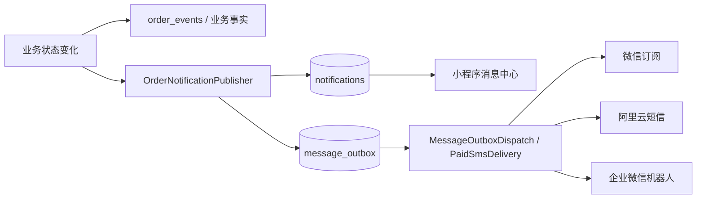

# 消息配置开发说明

> 2026-10-31 更新：订阅分类与提示展示以 [按身份订阅与统一悬浮通知](2026-10-31-角色订阅与统一悬浮通知.md) 为准；本文原“三个模板/日常两项”和内嵌额度提示为历史方案。

> 长期维护文档，事件/发送契约在本文；日常配置参见 [`server/docs/消息配置说明.md`](../server/docs/消息配置说明.md)。

## 1. 适用范围与代码入口

当前消息系统覆盖四类触达：

- 站内消息：用户、师傅的小程序消息中心。
- 微信订阅消息：用户主动授权后，由 PHP 服务端可靠发送。
- 阿里云短信：用户、师傅的重要业务提醒。
- 企业微信群机器人：管理员人工待办与系统异常提醒。

核心实现：

- 事件单一目录：`server/app/Domain/Messaging/MessageEventCatalog.php`
- 消息编排：`server/app/Application/Messaging/OrderNotificationPublisher.php`；订单投影与队列写入位于 `Infrastructure/Messaging`。
- 微信 / 短信发送：`server/app/Infrastructure/External/WeChatSubscribeGateway.php`、`AliyunSmsGateway.php`。
- 可靠队列消费：`server/app/Application/Messaging/MessageOutboxDispatch.php`；付费短信为 `PaidSmsDelivery.php`，Scheduler 仅调用。
- 后台配置入口：`server/app/Http/Admin/Modules/ConfigurationSettingsAdminModule.php`；SettingsRead / SettingsSave 负责四类设置页面及保存，模板、公共库、短信和测试发送各有独立用例。已保存的管理员身份/师傅电话策略由 WorkerRuntimeConfigSync 同步；后台同步师傅云资料也复用该用例。
- 小程序授权：`miniprogram/utils/SubscribeMessageUtils.js`
- 后台消息配置：`server/views/admin/settings.php`
- 后台队列运维：`server/views/admin/message-outbox.php`
- 订单/测量/维修/隐私申请事件：各业务 Application 用例；尚未迁出的业务通过历史消息门面调用同一新实现。
- 网页后台业务事件：`AdminOrderEventRecorder` + `DatabaseAdminOrderEventRepository`；Controller 只传入当前管理员 ID。

旧 OrderNotificationService、PaidSmsDispatchService、MessageEventCatalog、AliyunSmsService、WeChatSubscribeMessageService 保留历史调用签名并委托新实现，不再承担消息 SQL、字段规则或供应商请求。新增业务只能修改新分层；保留门面是为了兼容现有业务和视图调用。

配置保存共享数据库写锁、批量事务和审计时序。类目合法性由 Repository 查询；纯字段规则在 SettingsValuePolicy。settings.save 按 scope 限定组别，公告固定六个场景（首页、门店、下单、接单大厅、商家认证、报价订单）；单通知保存保留其他场景，模板测试必须使用后台管理员身份及实际授权。普通队列与付费短信分别消费，事务内禁止外部请求；付费短信以确认回执决定扣费，未知发送结果不得自动重发。

回归入口：tools/test-message-configuration.php、test-message-delivery.php、六组 *-settings-migration.php；真实持久化验证为 server/tests/v250_message_completion_mysql.php 与 v250_messaging_migration_mysql.php。使用隔离数据库和记录型供应商，不发送真实消息。

新增事件时，优先修改 `MessageEventCatalog`，不要重新在视图、控制器或调度器维护第二份中文标题、优先级和接收人清单。

## 2. 总体链路



基本原则：

- `order_events` 记录“发生了什么”，`notifications` / `message_outbox` 负责“通知谁”。
- `ApiController::event()`、`SchedulerService::recordOrderEvent()`、`AdminController::recordOrderEvent()` 已自动进入统一通知服务；同一事件后不要再手工调用一次 `OrderNotificationService::queue()`。
- 更换师傅等确需在状态切换前通知旧对象的特殊场景，可使用服务端内部 `notify_recipients` 限定本次接收人；不要用第二次全量入队制造重复消息。
- 演示订单只生成站内消息，不进入短信、微信订阅或企业微信外部队列。
- 非订单管理员事项使用 `queueAdminTask()`，当前只进入企业微信。
- 外部第三方请求不得在订单事务中直接执行，统一先写 `message_outbox`。

## 3. MessageEventCatalog：单一事件目录

V2.2.9 已将原先分散在 `OrderNotificationService`、后台视图和升级脚本附近的运行时事件元数据收敛到：

```text
server/app/Domain/Messaging/MessageEventCatalog.php
```

每个事件可定义：

- `label`：后台中文标题。
- `priority`：`important` / `normal`。
- `status`：站内消息与通用订单通知文案。
- `recipients`：`user` / `worker` / `admin`。后台必须按渠道显示接收人：企业微信固定为管理员，短信/站内只显示用户和师傅。
- `source_label`：事件常规触发来源，与接收人分开；实际管理员代办的订单通知标明“管理员代办”。
- `notification_retired`：重复或无待办事件已退出通知，旧配置也不能重新开启；订单事实和审计继续保留。
- `scene`：短信模板族，如 `order_status`、`quote_received`。
- `subscription_scene`：对应微信订阅场景。
- sms_visible / sms_default / sms_recommended / sms_priority / sms_flow：短信开关可见性、推荐启用值、分类与流程，历史开关不受新版默认值自动覆盖。
- `wecom_visible / wecom_default`：管理员企业微信配置页是否出现及迁移/初始化建议值。运行时不会用代码默认值绕过数据库开关。

后台设置页与通知投影都读取这一个目录；旧 MessageEventCatalog / OrderNotificationService 只是兼容门面。V2.2.9 SQL 中的事件 JSON 只是升级时补齐旧数据库的**迁移快照**，不是新的运行时事实源。

### 3.1 重要 / 普通分级

| 级别 | 判定 | 后台展示 |
| --- | --- | --- |
| 重要 | 需要人工处理、付款/退款、审核、争议、隐私公开、存在明确期限 | 默认展开 |
| 普通 | 进度同步、自动完成、无需立即操作的结果 | 默认折叠 |

短信和企业微信均支持（短信的重点定义以 sms_priority 为准，旧的重要等级只保留给企微）：

- 显示“已启用 x / 总数”。
- 单项勾选。
- 当前分组“全选 / 全不选”。
- 普通组默认折叠。
- 暗黑模式与移动端布局。

保存结构：

```json
{
  "order_submitted": {
    "enabled": true,
    "priority": "important"
  },
  "order_approved": {
    "enabled": false,
    "priority": "normal"
  }
}
```

兼容规则：

- 历史 `"event_key": true/false` 继续可读。
- 保存后自然升级为对象结构。
- 外部通知采用 fail-closed：数据库没有明确保存某事件键时，运行时一律视为关闭；目录中的 default 只供升级/初始化脚本参考。
- 已保存的 `enabled` 始终优先，不因打开页面被重置。
- 未识别的历史/未来键不会静默丢弃，保留原值并按“重要”显示。
- 新增短信/企微事件必须通过升级脚本或管理员勾选明确开启，不能仅靠代码目录默认值自动发送。

## 4. 站内消息

站内消息命中有效目录映射后写 notifications，由 notification.internal_event_switches 控制；有效事件未保存开关时默认开启。预约费支付成功、退款到账、预计服务费、自动评价和测量单关联等重复/无需操作事件已停用；测量付款仅通知师傅继续履约，不重复提醒付款人。它与短信、企微、微信订阅开关独立；审核/提现等专用系统消息按专用链路处理。

**聊天分支已实现的前端改版**：底部“门店”改为“消息”，使用`pages/chatMessages/index`承接“我的”页消息与待办，页内为“沟通 / 待办 / 通知”；原门店列表改普通页面，由首页“附近门店”进入。页面结构、路由适配、分页和角标去重以[订单聊天总设计第31章](订单聊天/订单聊天系统设计与开发说明.md#31-底部消息与消息待办迁移设计2026-10-22)为唯一真源，实施归S12～S14。

改版继续复用PHP待办事实、notifications和既有订阅/短信/企微链路；聊天不逐条复制为通知。PHP已扩展notifications.summary的订单业务关注并集及非订单未读计数，NotificationState再与Go聊天分项汇总；通知“全部已读”只覆盖其服务端截止范围，不清订单待办/聊天及新到通知。Go不可用时，待办与通知仍可独立读取和处理；聊天开关默认关闭，通知授权次数与发送配置仍沿用现有规则。

当前 V2.2.9 已统一覆盖：

- 审核、报价、派单、费用调整、完工、退款、争议、跑空费。
- 维修申请、维修撤回、维修拒绝/完成、超时可申请平台介入。
- 测量支付、现场加费、待补款、成果提交、补测、成果确认、自动确认、延期结果、冻结解冻、施工关联、测量退款。
- 师傅电话公开审核结果及自动取消。
- 提现审核通过、驳回、付款完成、付款失败。

提现结果使用 `queueWorkerWithdrawalResult()` 写站内消息。V2.2.9 不再向师傅展示无实际发送实现的 `withdrawal_result` 微信订阅授权入口。

### 4.1 防重复规则

业务控制器记录事件后，由统一事件方法自动调用消息服务。禁止以下形式：

```php
$this->event(...);
OrderNotificationService::queue(...); // 同一 event_type 再发一次，禁止
```

唯一允许的例外是**不同语义事件**，例如系统事实记录为 `assignment_auto_accepted`，随后对外按用户可理解的 `assignment_accepted` 发送一次通知；两者必须在代码注释中说明原因。

通知层还会结合 `template_key + data_json` 做站内幂等检查，队列层由 `topic + business_key` 唯一键防重复。

## 5. 微信订阅消息

### 5.1 当前场景目录

实际场景以 subscriptionSceneDefinitions() 为准；包括以下专用场景以及 user_order_update / worker_order_update 两个通用重要进度场景。配置步骤见 server/docs/消息配置说明.md：

| 场景键 | 用途 |
| --- | --- |
| `reviewResult` | 师傅入驻审核结果；项目已有固定模板字段 |
| `order_audit` | 订单通过、补资料、驳回 |
| `quote_received` | 收到报价 |
| `chat_unread` | 用户、师傅的聊天持续未读聚合提醒，重要通知 |
| `worker_assigned` | 安排/确认师傅 |
| `completion_submitted` | 完工待验收 |
| `refund_result` | 退款审核通过/驳回及退款处理中，到账提醒由支付机构提供 |
| `payment_pending` | 报价选择及测量加费后待支付 |
| `fee_adjustment` | 费用调整待确认 |
| `supplement_reminder` | 补资料临期 |
| `measurement_result` | 测量成果待确认 |
| `measurement_extension` | 冻结延期结果 |
| `repair_progress` | 维修进度及平台介入提醒 |
| `dispute_progress` | 争议处理中 |
| `worker_repair` | 师傅待处理维修 |
| `worker_rework` | 师傅待补测 |
| `worker_commission_due` | 师傅平台服务费待缴 |

`withdrawal_result` 已从 V2.2.9 移除：此前只有配置占位，没有真实发送入口，继续展示会诱导用户授权一个不会发送的场景。

### 5.2 后台字段映射编辑

订单类场景必须同时配置：

1. 微信公众平台模板 ID。
2. 同步真实模板字段并自动识别映射；不能可靠识别时在高级设置中补业务来源或固定文字。

例如：

```json
{
  "template_id": "微信公众平台模板ID",
  "field_map": {
    "order_no": "character_string1",
    "status": "phrase2",
    "time": "time3",
    "remark": "thing4"
  }
}
```

后台已提供可视化映射输入，不再要求维护人员直接修改整段 JSON。

后端保存时会校验：

- 场景必须属于服务端白名单。
- 模板 ID 只允许字母、数字、下划线和短横线。
- 场景要求的业务语义必须完整；额外微信字段可从系统已知业务来源或固定文字补齐。
- 微信字段必须匹配 `[A-Za-z_]+数字`，如 `thing1`、`phrase2`。
- 同一场景不能把两个业务字段映射到同一个微信字段。
- 半成品允许保存，便于分次配置；但**模板 ID + 所有要求语义字段均合法映射**后，场景才标记为 `available`。

因此，配置不完整时小程序不会发起无效授权，并显示“后台模板字段未配置完整”。

### 5.3 授权、次数与消费

1. 小程序通过 `subscriptions.status` 获取场景状态；前端调用 `wx.getSetting` 时必须带 `withSubscriptions:true`，否则不能可靠读取 `subscriptionsSetting`。
2. 只有 `available=true` 的场景可调用 `wx.requestSubscribeMessage`，并且只能挂在用户明确点击或支付回调等微信允许的触发点，禁止页面打开即弹。
3. 微信一次授权最多带 3 个模板；一次性模板与长期模板不能混在同一次调用中。批量续收因此每次只处理最多 3 类重要一次性通知。
4. **一次性订阅**：用户每次同意，对应场景 `remaining_count + 1`；微信发送成功后才 `-1`。用户勾选“总是保持以上选择”只代表后续合法调用可自动沿用允许/拒绝结果，**不等于长期订阅**，仍需在新的用户点击埋点再次调用接口才能继续累积次数。
5. **长期订阅**：仅当微信公众平台实际模板具备长期资格时配置为 `long_term`；用户同意后不使用次数模型。普通商业服务默认按一次性订阅处理。
6. 设置页不再使用“开关”表达一次性授权：重要通知使用一个“批量续收 +1”按钮，普通通知逐项“续收 +1”；长期订阅单独显示授权状态。
7. 用户授权结果通过 `subscriptions.preference` 保存；微信返回 43101 时服务端把一次性剩余次数同步归零，避免前端继续显示虚假额度。
8. 发送成功后 `MessageOutboxDispatch` 才通过配额端口扣减一次性次数；普通接口失败按可靠队列重试，不能在入队时预先扣次数。
9. 用户拒绝、授权耗尽、模板未配置、字段映射不完整、无 OpenID 时都安全跳过微信发送，不影响业务流程；按后台配置决定是否进入“订阅失败短信兜底”。

#### 5.3.1 小程序授权埋点

为减少“每个业务结果都单独建模板”的复杂度，本轮增加两个通用重要场景：

- `user_order_update`：派单异常、平台取消、电话公开、跑空费、退款处理中等用户重要进度。
- `worker_order_update`：安排接单、退款/取消、费用处理、争议、跑空费等师傅重要进度。
- 有更具体模板的事件仍优先使用专用场景；同一事件同时需要用户和师傅时，主场景负责一方，服务端自动给另一方补通用场景，避免“事件写了用户、师傅，但微信只发到一边”。
- 普通用户的订阅设置不会展示师傅订单场景；首次师傅入驻审核 `reviewResult` 通过独立申请上下文读取，避免日常“一键续收”浪费额度。
- `reviewResult` 有自己的入驻提交埋点，因此不再参与日常重要通知批量续收；`worker_assigned` 与 `measurement_extension` 已补入重要通知。


V2.4.1 只在与未来通知强相关的明确操作上增加授权，不做定时弹窗或页面进入弹窗：

- 提交订单：多师傅模式申请“订单审核 / 收到报价 / 用户重要进度”；抢单模式申请“订单审核 / 师傅接单 / 用户重要进度”。真正进入补资料流程后，再在补资料提交节点申请“审核 / 补资料临期 / 用户重要进度”。
- 选择师傅：施工单申请“师傅接单 / 完工待验收 / 费用调整”；测量单改为“师傅接单 / 测量成果 / 费用调整”。
- 补充资料：补一次订单审核结果。
- 提交退款：补一次退款结果（原有埋点保留）。
- 提交争议：补一次争议进度。
- 提交维修/测量售后、申请平台介入：补一次维修进度。
- 申请测量冻结延期：补一次延期结果。
- 师傅普通报价先申请 1 次“师傅重要进度”，用于后续被选中/安排等结果；确认接单或抢单时一次补最多 3 类核心师傅通知。施工完工、测量成果提交时再利用新的明确点击分别补充“服务费 / 维修 / 重要进度”或“补测 / 维修 / 服务费”。
- 师傅入驻提交：继续按实际剩余次数决定是否申请审核结果订阅。
- 提现结果仍只走站内消息，不再调用不存在的 `withdrawal_result` 微信订阅场景。

#### 5.3.2 设置页、消息中心与自诊断

- “微信授权设置”固定排在消息模块第一项；从系统设置返回后立即重新读取订阅状态。
- 消息中心在微信总开关关闭、重要模板被拒绝/禁止、重要一次性次数为 0、长期重要模板未授权时展示轻量提醒，并跳转到对应处理入口。
- 自诊断只读取：微信能力、平台总开关、微信总开关、可用/未完整模板数、一次性剩余次数、长期授权数、拒绝状态。**不提供清理本地缓存功能，也不会删除下单草稿、量房本地标注或其他本地数据。**
- 不提供“测试推送”作为普通用户自诊断动作，因为真实微信测试会消耗一次性订阅次数。

### 5.4 小程序环境值

微信发送接口只使用：

- `formal`：正式版
- `trial`：体验版
- `developer`：开发版

后台选择项、发送服务和 V2.2.9 升级脚本已统一。历史 `release` 自动迁移为 `formal`，历史 `develop` 自动迁移为 `developer`。

## 6. 阿里云短信

- 短信只面向用户和师傅，不给管理员发短信。
- 目前模板族为 `order_status`、`quote_received`、`payment_success`，附近师傅邀约使用独立付费短信链路。
- 目录中的新测量/维修事件可以出现在配置页，但新增事件默认关闭短信；运营人员可按实际需要勾选。
- 测量成果确认、自动确认、解冻、施工关联等普通进度默认只走站内消息，避免无操作价值的短信费用。
- 后台测试短信直接调用供应商，会产生真实费用，但不进入订单队列。
- 附近师傅付费短信有独立余额预占、送达回执和计费事实，不允许从普通发件箱“人工重发”。

## 7. 企业微信机器人

企业微信只用于管理员事项。

### 7.1 标题规则

首行必须直接说明事项：

```text
【用户申请公开师傅电话】
【测量冻结延期申请】
【用户提交完工争议】
【师傅提交新的提现申请】
```

禁止恢复：

```text
【壁选后台待办】
【壁选订单提醒】
```

`queueAdminTask()` 会清理标题中的换行和括号，并将具体 `title` 同时写入 `payload_json`。

订单型管理员消息由目录中的实际 `status` 作为标题；只有异常空标题才回退到稳定 `event_type`。

### 7.2 显式管理员任务与通用通知

实名认证、商家认证、提现、电话公开申请、测量冻结延期、完工争议等使用 `queueAdminTask()`。

同一业务如果已经显式调用 `queueAdminTask()`，通用事件目录不要再给该事件添加第二个 `admin` 接收人，否则会产生两条企业微信消息。维修平台介入已经按此规则处理：师傅走通用通知，管理员走显式待办。

企业微信正文不得放完整手机号、身份证号、Webhook、密钥或私有图片地址。

## 8. 可靠队列、卡死回收和死信处理

普通外部消息主题：

- `wechat_subscribe`
- `aliyun_sms`
- `wecom_webhook`

状态：

```text
pending / failed -> processing -> processed
                         |
                         -> failed -> 自动重试
failed(>=5次) -> pending  人工重试
failed(>=5次) -> closed   人工结案
```

### 8.1 自动重试

- 单条最多自动尝试 5 次。
- 失败后按约 1、2、4、8、16 分钟退避。
- 调度器领取消息时将 `next_attempt_at` 写为当前时间 + 10 分钟，作为 processing 租约。
- 若 PHP 进程、服务器或网络异常导致消息一直停在 `processing`，下次调度发现租约过期会自动改回 `failed` 并继续剩余重试，不再永久卡死。
- 成功后清空 `next_attempt_at` 和错误信息。

### 8.2 后台死信

后台“消息发送记录”已支持以下普通主题达到 5 次失败后的：

- 人工重试
- 人工结案

支持主题：

- `aliyun_sms`
- `wecom_webhook`
- `wechat_subscribe`

附近师傅付费短信明确排除在普通人工重发外，防止重复扣费或重复骚扰。

队列后台只展示脱敏元数据，不展示手机号、OpenID、Webhook 或正文。人工重试可能造成重复触达，管理员需先判断供应商上一次请求是否可能实际成功。

## 9. V2.2.9 测量、维修与隐私消息

| 业务 | 事件 | 级别 | 当前默认触达 |
| --- | --- | --- | --- |
| 测量支付/加费 | `measurement_service_paid`、`measurement_change_paid` | 重要 | 用户、师傅站内；短信可配置，默认不新增开启 |
| 测量待补款 | `measurement_change_accepted_pending_payment` | 重要 | 用户站内 |
| 测量成果 | `measurement_result_submitted` | 重要 | 用户站内 |
| 用户要求补测 | `measurement_rework_requested` | 重要 | 师傅站内 |
| 成果确认/自动确认 | `measurement_result_accepted`、`measurement_auto_accepted` | 普通 | 用户、师傅站内 |
| 冻结延期申请 | `measurement_hold_extension_requested` | 重要 | 管理员企业微信 |
| 延期结果 | `measurement_hold_extension_approved/rejected` | 重要 | 用户站内 |
| 测量结算 | `measurement_income_released` | 普通 | 师傅站内 |
| 关联施工 | `measurement_construction_linked` | 普通 | 用户、师傅站内 |
| 测量退款 | `measurement_*_refund_*` | 重要 | 用户站内 |
| 维修申请/处理 | `warranty_repair_*`、`repair_*` | 按目录 | 用户/师傅站内；平台介入额外企微 |
| 电话公开申请 | `worker_contact_reveal_requested` | 重要 | 管理员企业微信 |
| 电话公开结果 | `worker_contact_reveal_approved/rejected` | 重要 | 用户；批准时师傅也收到站内说明 |
| 电话申请自动取消 | `worker_contact_reveal_cancelled` | 普通 | 用户站内 |
| 提现结果 | `withdrawal_result`（站内 template_key） | 重要 | 师傅站内，不申请微信订阅 |

完整手机号不会写入消息正文；审核通过后由订单详情按权限读取。

## 10. 新增消息场景的开发顺序

1. 先完成业务事务与事件事实记录。
2. 在 `MessageEventCatalog` 增加事件中文名、级别、接收人和外部通道策略。
3. 通过统一 `event()/recordOrderEvent()` 进入 `OrderNotificationService`；不要在同一节点再手工二次 `queue()`。
4. 如需微信订阅，复用现有场景或在 `subscriptionSceneDefinitions()` 增加真实场景，并定义 `field_semantics`。
5. 后台配置真实模板 ID 和完整 field_map，再真机授权测试。
6. 如需短信，确认模板变量与供应商模板完全一致，并谨慎决定默认开关。
7. 如需管理员企微，决定由目录中的 `admin` 接收人还是显式 `queueAdminTask()` 负责，二选一。
8. 如新增队列主题，同步实现调度、后台主题标签、重试/结案、脱敏和计费边界。
9. 更新本开发说明和 `server/docs/消息配置说明.md`。
10. 把关键约束加入 V2.2.9 回归工作流。

## 11. 验收清单

- [ ] 站内消息在外部通道关闭时仍正常。
- [ ] 同一业务事件只产生一组预期通知，不因 `event()+queue()` 双调用重复。
- [ ] 演示订单不产生短信、微信订阅或企微外部队列。
- [ ] 企业微信首行是具体事项标题，不出现“壁选后台待办 / 壁选订单提醒”。
- [ ] 重要消息默认展开、普通消息默认折叠，全选/全不选与启用计数正确。
- [ ] 历史布尔事件开关继续可读，保存后升级为 `enabled + priority`。
- [ ] 微信模板 ID 或 field_map 不完整时，前端不允许发起无效授权。
- [ ] 微信订阅发送成功才消耗一次性次数；失败仍进入自动重试。
- [ ] `wx.getSetting({withSubscriptions:true})` 能读取总开关及持久化模板状态。
- [ ] 一次批量授权不超过 3 个模板，且一次性/长期模板不混用。
- [ ] 重要通知批量续收每次最多 3 类各 +1，普通通知可逐项 +1。
- [ ] 消息中心能提示总开关关闭、拒绝/禁止、重要次数为 0、长期重要模板未授权。
- [ ] 自诊断不调用 `wx.clearStorage*`，不清理下单草稿、量房本地标注或其他本地缓存。
- [ ] processing 消息超过 10 分钟租约可以自动回收。
- [ ] 短信、企微、微信订阅达到 5 次失败后可人工重试或结案。
- [ ] 附近师傅付费短信不能通过普通人工重试入口重发。
- [ ] 测量、维修、隐私公开、提现结果可在对应角色的站内消息中心看到。
- [ ] 消息后台不显示手机号、OpenID、Webhook、身份证号或正文敏感信息。
- [ ] `formal / trial / developer` 与微信接口枚举一致。
- [ ] 真机验证订阅同意、拒绝、消耗、跳转路径和模板字段类型。

## 12. 当前仍需上线验证的事项

代码层面的原 7 项待完善内容已在 V2.2.9 收口。剩余重点不是继续扩充消息通道，而是上线前验证：

1. 在微信公众平台为实际小程序类目选择匹配的真实模板，并逐个填完 field_map 后真机发送。
2. 根据真实运营频率决定测量、维修类哪些重要事件值得额外开启短信；默认保持新增短信关闭。
3. 上线后观察 `message_outbox` 的失败类型，确认 10 分钟 processing 租约和 5 次退避策略适合当前服务器/供应商响应时间。
4. 如未来确实需要“提现微信订阅通知”，必须先实现真实发送入口和匹配的微信模板，再重新增加场景；不能只恢复一个授权开关。
5. 若后续继续合并微信模板族，应先迁移用户偏好和现有模板配置，避免直接改场景键造成历史授权状态失效。


## 13. 当前后台页面与模板操作

- 当前代码仍有 internal / subscribe / sms / wecom 四个渠道分页，保存停留原分页；企微分页仍存在是实现事实，不据旧需求宣称已删除。
- 订阅左侧场景、右侧编辑器；保存当前通知只合并该场景，总开关独立保存。URL/隐藏字段记录 scene，识别、绑定、测试、同步后停留当前场景；未保存状态明确提示。
- 模板必须属于当前 AppID。导入 priTmplId 或从公共库选 2～5 关键词→addtemplate→gettemplate，同步实际标题、类型和字段。
- 自动按中文标签识别 order_no/status/time/amount/worker_name/remark/service_name；高级设置填 time3 而不是 {{time3.DATA}}。业务来源与固定文字互斥，不写死“壁选/壁选服务”。
- 每个真实微信字段都必须有来源；缺项可保存但保持待配置、不授权不发送。reviewResult 使用专用 name1/phone_number2/phrase3/thing5，忽略旧通用映射；结构不符明确报错，不阻断保存其他场景。
- 公共模板必须先选具体类目、输入关键词、点击搜索；打开/改类目不拉模板，不支持全部类目。每次最多 90 条/3 个分页请求，继续搜索由管理员主动点击；完全匹配或 20 条结果可提前结束。
- 类目缓存 6 小时，标题分页/关键词缓存 24 小时，复用私有 access_token 缓存；45009 停止搜索，有旧缓存可提示使用。空响应/非 JSON 显示可读错误，保留已取得结果，不自动扫 3000 条。

## 14. 授权续收、测试与短信兜底

- 一次拒绝不清掉此前剩余次数；微信明确无权限时才归零。reviewResult 不占日常重要续收槽位，普通用户不显示师傅模板。
- 消息中心重要次数为 0/1 时可直接续收最多 3 类；总开关关闭/拒绝时跳微信授权设置。已持久允许的模板仅在合法用户操作或支付成功回调续收，不用定时弹窗。
- 争议发起不立即用完用户刚授权的处理结果次数，后续结案再使用；业务埋点按当前 SubscribeMessageUtils 和页面代码维护。
- 管理员企业微信通知支持订单审核、师傅/商家审核与提现四类测试入口，使用已保存的机器人配置，要求后台权限、POST 和 CSRF；可独立于业务事件开关测试，不创建真实待办。测试内容明确接收人、示例来源和发送管理员；成功只表示供应商受理，仍需群内核对卡片/网页处理入口，失败不回显密钥。
- 聊天 `chat_unread` 纳入重要通知，用户与师傅均可续收；内部通知页有直达配置入口，发送示例与生产文案一致。持续未读按既有聚合/最终复验链路处理，不逐条写 notifications，不自动转付费短信。
- 管理员场景测试仅用已保存模板和已配置管理员 OpenID，要求已登录映射与对应授权；一次性成功消耗 1 次，43101 归零，失败不扣；不造订单/内部通知。
- 短信分建议短信、订阅失败兜底、其他可选短信；internal_only 的低价值支付/自动结果不被旧开关重新拉回短信。
- 兜底只适用于配置允许的事件：微信条件不可用立即入短信；微信入队时不并行短信；确定不可重试错误或有限重试耗尽后转短信。成功受理但用户没阅读不算失败。
- 兜底业务键 <eventKey>:<recipientType>:<recipientId>:sms-fallback，入队前重读当前开关/模板；推荐短信仍可独立并行。
- 精简方案只开推荐短信；高可靠方案额外开重要订阅失败兜底，管理员主动应用，可能增加费用，不自动覆盖设置。
- 类型格式按微信限制：thing≤20、phrase≤5个纯汉字、含汉字姓名≤10（纯英文≤20）、character_string≤32、车牌≤8；time 为有效 HH:mm、date 为有效 YYYY-MM-DD、amount 为 ¥数字。长订单状态在短语字段显示“进度更新”，具体事项保留备注。详见[47003 与字段校验](2026-11-01-微信订阅47003与字段校验.md)。

### 14.1 入驻审核与消息权限提醒整合（2026-10-20）

- `pages/record/record` 不再把“已进入审核”和“订阅提醒次数不足”渲染成上下两个独立横幅。通过 `subscription-health-banner.reviewPending` 将两种状态合并为同一紧凑横幅：仅有一条时静态显示，两条同时存在才在同一区域每 3 秒纵向轮播；数据更新时自动重组，不创建新审核任务、不增加微信订阅授权请求。
- “已进入审核”只告知审核资料状态，不把点击动作错误地跳去通知设置；订阅异常那一屏保留“去设置”，仍前往 `pages/mine/settings?section=notifications&audience=worker`。订阅状态读取失败不隐藏已确认的审核状态；`reviewPending` 仅为入驻页启用，其他引用公共组件的页面维持现有判定。
- **2026-10-20 视觉回退与尺寸纠错**：入驻审核提醒不是改成统一橙色通知条，而是在同一个纵向轮播位置内保留原来的绿色 `review-waiting-card`（58rpx 方形图标、原文案与圆角、原暗黑色）；通知不足保留原版橙色 `subscription-health-banner` 的色彩、图标与层级，只调整内部水平间距与尺寸。入驻页原先叠加“页面 24rpx + 组件 24rpx”左右边距，现轮播内卡片 `margin:0`，让“去设置”靠近右侧；该按钮保留淡橙色小底框，其他页面仍保留独立通知卡。
- 设置页单条“接收/去设置”修正此前误用的 `background:transparent`，恢复可见的浅青色小底框、边框和 24rpx 字号，暗黑模式使用深青色框；禁用态也显示边界。批量按钮仍为紧凑浅色样式。`pages/orderCenter/index` 不只缩文字按钮，还将整个搜索输入框从 76rpx 高收至 68rpx，搜索操作改为可点击 `view`，避免微信原生 `button` 默认内边距/最小尺寸撑大搜索区。
- **2026-10-20 第三轮精确对齐**：`pages/orderCenter/index` 搜索按钮与其上方的订阅横幅“去设置”按钮使用相同的 `84rpx × 50rpx`、`23rpx` 字号、`12rpx` 圆角和 `0 4rpx` 内边距；两者各自的外边距、右内边距统一为 `24rpx + 12rpx`，保持右边缘上下对齐。输入框本体仍为 `68rpx` 高。
- `pages/mine/settings` 的“批量接收”与单条“接收/去设置”统一 `24rpx` 字号、`48rpx` 高、`0 8rpx` 内边距、`10rpx` 圆角；保留浅色底框及暗黑状态。分组标题和订阅项最右留白从 `24/28rpx` 分别缩至 `12rpx`。
- 入驻页审核横幅恢复原有绿色卡片及文案，并针对其迁入独立组件后丢失 ColorUI 图标的问题，设置 `styleIsolation: 'apply-shared'` 允许继承全局 `cuIcon-timefill`；轮播固定高度从 `180rpx` 收紧为 `152rpx`，减少上下空白并保持双提醒轮播。测试新增按钮尺寸与边距一致性、审核图标继承的约束；并继续检查暗黑模式。
- **2026-10-20 暗黑通知与按钮收口**：微信小程序原生 `button` 的默认布局使设置页批量/单条接收背景框远大于文字。本次仅将通知操作换为自适应文字宽度的 `view role="button"`，布局使用 `inline-flex; flex:0 0 auto; width:auto`，保留 16rpx 右边距和业务层点击校验。批量接收改为醒目的深青色实心底框、白字；单项接收/去设置采用浅底描边，内边距比原生按钮更紧凑；忙碌和不可接收状态仍禁用，并在点击处理方法中复核。该修改只影响按钮 UI，不改变微信订阅请求类型及调用条件。
- **所有通知不足横幅的暗黑适配**：公共 `subscription-health-banner` 被入驻、下单、接单等页面共用；修复 `.warning` / `.attention` 浅色背景优先级高于暗黑普通规则的问题，在暗黑状态下明确统一使用深色背景、亮色标题/说明和可读的“去设置”。审核绿色卡片仍维持原有配色。回归测试验证 3 秒轮播、控件宽度、权限阻断、重复点击及暗黑提示样式。
- 新增 `tools/test_v260_onboarding_notice_compact_ui.js` 回归无提醒、审核单提醒、订阅单提醒、双提醒轮播、网络失败、点击去设置、旧异步响应和相关 CSS。未更改 PHP 消息规则、授权次数、短信兜底或数据库。

## 15. 企业微信处理入口

- 管理员企微优先使用**确实存在且能处理该事项**的小程序页面：师傅入驻审核走 `pages/mine/examine?source=worker`，商家审核走 `pages/mine/examine?source=store`，订单事项走管理员订单工作台；没有对应小程序能力的事项才回退网页后台，不得一律提示“没有处理页面”。
- 管理员企微使用官方 text_notice 文本通知模板卡片，跳转指引包含本站 HTTPS 后台与小程序（复用微信设置 AppID）；卡片不支持按手机号 @，旧配置保留并明确说明。API 受理与群内实际送达分开显示。详见 [2026-11-01 卡片及路径修复](2026-11-01-企业微信文本通知卡片.md)。
- 管理员企微网页跳转只允许本站 `/admin/?route=...` 的受控参数，禁止外部地址、任意跳转参数；每次新增通知事件都要检查 `action_path`、小程序实际页面、处理权限和降级路径。


OrderNotificationProjector 写 action_path，WeComAdminNotifier 仅接受受控 /admin/?route= 路径，用配置 HTTPS app.url 拼链接；后台会话继续鉴权，不传外链 token。无 @ 手机号用 Markdown 立即处理链接，有 @ 则 text + 完整链接。CLI 也必须读取正确 app.url，不能从用户文本或 Host 拼网址。

新增事件、批次/租约与背压遵守 [架构设计](模块化单体与解耦架构设计.md)；付费附近邀请仍按独立钱包/送达规则，不纳入普通人工重发。


## 入驻通知与审核结果通知的核对

- 入驻提交 → 企业微信群机器人 → 管理员；发布审核页的“审核结果通知” → 微信订阅消息 → 申请人。这两条链路的状态不能互相证明。
- 历史 a93f2ed 引入的小程序卡片出现“已受理但群内未见”反馈；2026-10-31 修复后统一 text，每事件只发一次，回执保留机器人指纹供核对，不把 API 受理推断为群送达。
- 企业微信成功必须明确返回数字 0 或字符串 "0"；空对象、非数字、空值、布尔值不能当作成功。正文按 UTF-8 字节控制 text 2048、markdown 4096 上限。
- 成功回执和队列完成在一次更新中写入现有 message_outbox.payload_json.delivery_receipt：供应商、受理码、消息类型、UTC 受理时间、机器人地址 SHA-256 的前 12 位。只保存脱敏标识，不保存地址/密钥，不把群消息受理解释为已读。
- 消息记录中企业微信 processed 显示“接口已受理”；历史记录未保存回执，不能事后伪造。核对未收到的通知时，对照业务编号、时间、消息类型、机器人标识和服务器实际部署版本，再在对应企业微信群核验。单凭旧“已发送”不能确认具体失败原因。
- 正式站未读日志/回执、未做真实接收验收前，只能报告代码缺陷和待核实项，不宣称已修复具体某条消息的最终送达。

本次需要更新 PHP 后台和重新发布小程序前端；没有表结构变更，不需要数据库升级，也不需要更新 worker 云函数。历史消息不自动重发。

队列仅重试 next_attempt_at 明确到期的 failed 记录；终止失败的空重试时间不再被当作“立即到期”，领取阶段再次核对时间与重试次数，避免审核订阅消息永久错误被继续发送。

验证记录：独立公开测试仓库 [40521866863](https://github.com/franz-9527/workers-server/actions/runs/40521866863) 通过；49 个源码/测试文件与代码提交 `c12ce0bc23adac1dcf5c6bb6c2e3ea133aff4262` 逐个 Git blob 校验一致。覆盖模拟企业微信返回、手机号提醒、字节上限、审核页实际执行、既有 52 项发送回归、审核迁移及隔离 MySQL 5.7.44 的回执/队列/状态匹配。没有执行本地测试、主仓库 Actions、真实企业微信发送或正式站部署；10 月 12 日正式记录最终投递情况仍需生产日志核验。

### 2026-10-31 消息请求与回执补全

所有消息配置辅助动作拆为独立原生表单，分类保存仅提交当前分类；短信 CODE 和事件布尔开关使用紧凑数据。直接管理员测试通过 MessageTestJournal 写入原有 message_outbox，失败／进程中断不自动重试测试。业务发件箱在三个外部渠道均保存可核对回执；聊天订阅保留其自身的不重复发送策略，并写入诊断回执。发送记录读取独立渠道及身份筛选，站内消息读 notifications，每页 20 条；历史无角色的聊天任务显示账号，不猜测身份。退款请求不作为消息展示。

小程序审核由 admin.worker.review 统一进入可靠发件箱，云端保留旧接口兼容；列表按精确资料编号查最新状态，等待和未记录状态每次刷新重查。师傅身份投影不再限制历史 OpenID 前缀；重新提交清空 reviewNotice、reviewTime，审核保存本轮时间，查询排除较早回执。公告接口公开只读且 no-store，服务端按部署站点配置返回；首页、门店停止读取共享云端固定公告，前端对站点切换与过期响应做隔离。无 SQL 迁移或新增集合，公告页仅补现有配置行。发布步骤与已知边界见 [本次修复记录](2026-10-31-消息请求回执与公告隔离.md)。

## 首页与微信提醒修正（2026-10-31）

首页不再展示或主动查询微信提醒次数不足。浮动提醒仅在消息及相关业务页出现，文案简化并允许换行；一次性续收和长期授权分别处理，避免重复点击授权。聊天可用性按真实签名／恢复条件判断，凭证失败共享等待期，后台可查看缺项诊断。更新 PHP 与小程序即可，无本次 SQL 迁移或云函数更新。详见 [聊天就绪与首页提醒修复](2026-10-31-聊天就绪检查与首页提醒修复.md)。
